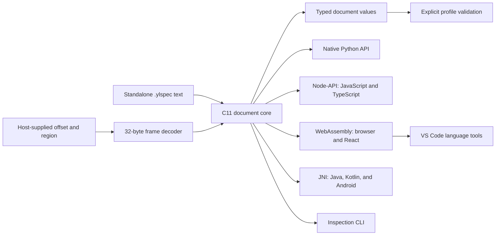

# YLSpec

[](https://github.com/YoungLionOrganization/YLSpec/actions/workflows/ci.yml)
[](https://pypi.org/project/ylspec/)
[](https://pypi.org/project/ylspec/#files)
[](LICENSE)
[](docs/specification.md)
[](docs/compatibility.md)
[](docs/c-api.md)
[](javascript/README.md)
[](jvm/README.md)
[](editors/vscode/README.md)
[](docs/compatibility.md)

**Portable metadata documents that work on their own and inside other file formats.**

YLSpec defines a versioned document envelope around TOML 1.1 and an optional,
length-delimited binary frame for embedding that document into another file.
The reference implementation is written in C11. Its Python package uses the same
C core through a native CPython extension. JavaScript and TypeScript use Node-API
on Node.js and WebAssembly in browsers and React applications. Java and Kotlin
use JNI on desktop JVMs and Android. A VS Code extension brings the same parser
to `.ylspec` editing.

**Status:** `0.1.1`, experimental. The specification and APIs may change before
1.0. Review the [compatibility policy](docs/compatibility.md) before depending on
an experimental version. A release's support claims are backed by its linked
GitHub Actions run. Package-registry publication requires the account setup
described in the [registry guide](docs/registries.md); release assets can be used
independently of those uploads.

## Why YLSpec?

Applications frequently need the same metadata in several contexts: editable
configuration, a component manifest, or a small record embedded in a larger
binary file. YLSpec gives those contexts a shared document model and an explicit
version boundary.

| Capability | Standalone document | Embedded frame |
|---|---|---|
| Human-editable UTF-8 TOML 1.1 | Yes | The payload is the same text |
| Standard and profile versioning | Yes | Yes |
| Namespaced project extensions | Yes | Yes |
| Exact temporal literals | Yes | Yes |
| Read without touching unrelated host content | Entire document | Header plus declared document bytes |
| Requires an archive or decompressor | No | No |
| Executes embedded code | No | No |

YLSpec does not define plugin execution, package installation, dependency
resolution, signatures, or a host file's layout. Future formats can place YLSpec
frames wherever their own headers or indexes specify.

## Architecture



The [embedding guide](docs/embedding.md) explains the byte layout and the host's
responsibilities. The [normative specification](docs/specification.md) defines
document validity independently of the reference implementation.

## Installation

Install the published native Python package with:

```sh
python -m pip install ylspec
```

Version `0.1.1` is available on [PyPI](https://pypi.org/project/ylspec/0.1.1/) and
in the checksummed [GitHub Release](https://github.com/YoungLionOrganization/YLSpec/releases/tag/v0.1.1).
For offline installation, download a matching release wheel and install it with
`python -m pip install path/to/the-wheel.whl`. Verification-only builds are also
available in successful **CI** runs' `wheels-*` artifacts.

Native release assets contain both `static/` and `shared/` installations, with
headers, libraries, CLI binaries, CMake package exports, and license notices.
Choose one installation as your CMake prefix:

```cmake
find_package(YLSpec CONFIG REQUIRED)
target_link_libraries(my_application PRIVATE YLSpec::ylspec)
```

See [building](docs/building.md) for source builds and supported toolchains.

### Other language packages

| Consumer | Distribution | Integration guide |
|---|---|---|
| JavaScript / TypeScript / Node.js | `@younglionorganization/ylspec`, native Node-API | [JavaScript API](javascript/README.md) |
| Browser / React | The same npm package, bundled C WebAssembly | [Browser initialization](javascript/README.md#browser-and-react) |
| Java / Kotlin desktop | `io.github.younglionorganization:ylspec` and `ylspec-kotlin` | [JVM guide](jvm/README.md) |
| Android | Common Java/Kotlin API plus `ylspec-android` JNI AAR | [Android dependencies](jvm/README.md#android) |
| VS Code | `ylspec-0.1.1.vsix`; language tools using bundled WebAssembly | [Editor guide](docs/vscode.md) |

These names describe the built distributions. npm, Central, and Marketplace
listings become available after their separate publishing workflows succeed.
Until then, use the checksummed tarball, Maven-layout ZIP, or VSIX from the
GitHub Release. No registry availability badge is shown before publication.

```javascript
import {createClient} from '@younglionorganization/ylspec';
const yl = await createClient();
const document = new yl.Document({name: 'Example', count: 42n});
const restored = yl.unpack(yl.pack(document));
console.assert(restored.data.count === 42n);
```

Integer values are `bigint` in JavaScript and `Long` in Java/Kotlin. Exact
temporal values retain their original fractional precision across adapters.
The [type mapping](docs/compatibility.md#language-type-mapping) explains conversion
boundaries. Browser initialization is asynchronous; once initialized, in-memory
parsing and framing use the same synchronous C implementation.

## Document example

```toml
[_ylspec]
version = "0.1"
profile = "core.data"
profile_version = "0.1"

[data]
name = "Example component"
enabled = true
platforms = ["linux-x86_64", "windows-x64", "macos-arm64"]

[extensions."xyz.younglion.example"]
channel = "stable"
```

`data` is application-defined. An application's version inside `data` is
independent of the YLSpec format version and the profile version.

## Python quick start

The complete, CI-executed example is [examples/basic.py](examples/basic.py).

```python
import io
import ylspec

document = ylspec.Document({"name": "Example", "enabled": True})
document.validate()

text = ylspec.dumps(document)
restored = ylspec.loads(text)
assert restored.data == document.data

prefix = b"host-defined prefix"
frame = ylspec.pack(document)
host = io.BytesIO(prefix + frame + b"unrelated payload")
metadata = ylspec.read_at(host, offset=len(prefix), available=len(frame))
assert metadata.data["name"] == "Example"
```

`read_at` restores the stream's original position. It reads the 32-byte header
and exactly the document bytes declared in that header. Determining the region
size may seek to the end, but does not read the host payload.

See the [Python API](docs/python-api.md) for types, profile validators, errors,
and exact timestamps. Detailed `__init__.pyi` and `_native.pyi` stubs and a
`py.typed` marker ship with the package for editor completion and static checks;
no separate stub distribution is required.

## C quick start

The complete, CI-executed example is [examples/basic.c](examples/basic.c).

```c
#include <stdio.h>
#include <string.h>
#include <ylspec.h>

int main(void) {
    const char text[] =
        "[_ylspec]\nversion='0.1'\nprofile='core.data'\n"
        "profile_version='0.1'\n[data]\nname='Example'\n";
    yl_document *document = NULL;
    yl_error error = {0};
    if (yl_parse(text, strlen(text), NULL, &document, &error) != YL_OK) {
        fprintf(stderr, "%s\n", error.message);
        return 1;
    }
    yl_document_free(document);
    return 0;
}
```

Lengths are explicit; the input does not need a terminating NUL. The core does
not open files. A host can supply a `yl_read_at_fn` callback to read an embedded
document from a file, mapping, device, or other bounded source.

## Resource limits and trust boundaries

| Property | Default or policy |
|---|---|
| Maximum document text | 16 MiB; configurable |
| Maximum value depth | 64 edges from root; configurable up to 128 |
| Frame header | 32 bytes, little-endian |
| Embedded text | UTF-8 TOML 1.1, uncompressed |
| Integer / float | Signed 64-bit / IEEE-754 binary64 |
| Required feature or profile validation | Explicit; unsupported means failure |
| Integrity and authenticity | Supplied by the host, if needed |

Additional parser limits are listed in [compatibility](docs/compatibility.md).
Parsing does not imply profile approval, cryptographic verification, or
permission to execute host content. See [security](SECURITY.md).

## CLI

```sh
ylspec --version
ylspec validate examples/config.ylspec
ylspec inspect examples/manifest.ylspec
ylspec pack examples/config.ylspec > metadata.bin
ylspec inspect-frame metadata.bin 0
```

See the [CLI reference](docs/cli.md) for commands, output, and exit codes.

## Verification and releases

GitHub Actions builds static/shared C artifacts and Python wheels, runs C and
Python tests, checks TOML 1.1 decoding against `toml-test`, runs sanitizers and
bounded fuzzing, executes documentation examples, and renders Mermaid diagrams.
Benchmark reports record the workload and environment without asserting an
unmeasured speed threshold.

Language verification executes Node-API and JNI on the target systems, tests
TypeScript ESM/CommonJS consumers, launches React in Chromium, builds four
Android ABIs, executes JNI on an API 26 emulator, and tests a real VS Code
Extension Host before packaging the VSIX.

The manually dispatched publish workflow rebuilds and verifies one commit,
creates a draft release, attaches checksummed assets, publishes the same Python
distributions to PyPI using the `PYPI_API_TOKEN` GitHub Actions secret, and then
publishes the GitHub Release.
Read [publishing](docs/publishing.md) before the first release.
Separate npm, Maven Central, and VS Code workflows consume the public release's
checksummed artifacts. See [registry setup](docs/registries.md) for exact secret
names, account ownership, and upload steps.

## Documentation map

| Guide | Audience |
|---|---|
| [Specification](docs/specification.md) | Independent implementers |
| [Embedding](docs/embedding.md) | Host-format designers |
| [Profiles and extensions](docs/profiles.md) | Application developers |
| [C API and ownership](docs/c-api.md) | C integrators |
| [Python API and types](docs/python-api.md) | Python integrators |
| [JavaScript, TypeScript, browser, and React](javascript/README.md) | Web and Node.js developers |
| [Java, Kotlin, and Android](jvm/README.md) | JVM and Android developers |
| [VS Code integration](docs/vscode.md) | Editor users and extension maintainers |
| [CLI](docs/cli.md) | Users inspecting documents |
| [Building](docs/building.md) | Native-library consumers |
| [Compatibility](docs/compatibility.md) | Maintainers and adopters |
| [Publishing](docs/publishing.md) | Release maintainers |
| [Registry accounts and secrets](docs/registries.md) | Package publishers |

## License and authorship

Copyright 2026 **Cavanşir Qurbanzadə**. Created under **YoungLionOrganization**.
Original project material is licensed under [Apache-2.0](LICENSE).
See [NOTICE](NOTICE), [AUTHORS.md](AUTHORS.md), and
[third-party notices](THIRD_PARTY_NOTICES.md). A document created by a user does
not acquire this project's license merely by using the YLSpec format.
