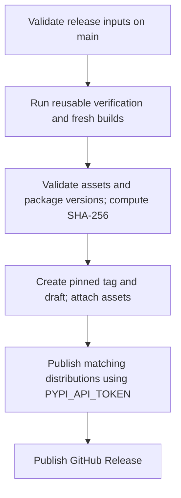

# Publishing YLSpec

Publishing is an explicit maintainer action. Ordinary pushes run verification
and create workflow artifacts, not GitHub Releases or PyPI uploads.

## Release inputs

| File | Responsibility |
|---|---|
| `release/release.json` | Authoritative version, title, notes path, prerelease flag |
| `release/notes/vVERSION.md` | Detailed English release notes |
| `release/assets.json` | Required native targets, wheel families, asset names |

CMake, Python package metadata, release scripts, and the Git tag derive their
version from `release.json`. Update that source once and include its notes in the
same commit. The npm and VS Code manifests are checked against the same version;
update their public manifest fields in the release commit. The JVM publication
version is read from that source by Gradle. Do not commit compiled outputs into
`release/`.

## One-time PyPI API token setup

The workflow authenticates using a PyPI API token stored as a GitHub Actions
repository secret. An existing token can be used if it permits uploading the
`ylspec` project. Prefer a project-scoped token when that project already exists.

1. Open [the repository's Actions secrets settings](https://github.com/YoungLionOrganization/YLSpec/settings/secrets/actions).
2. Select **New repository secret**.
3. Set **Name** to exactly `PYPI_API_TOKEN`.
4. Paste the complete PyPI API token, including its `pypi-` prefix, into **Secret**.
5. Select **Add secret**.

Create the entry under **Secrets**, not **Variables**. Do not commit the token,
place it in release metadata, or add it to an example file. The workflow passes
`${{ secrets.PYPI_API_TOKEN }}` directly to the publishing action's password
input and uses the literal username `__token__`.

The repository's `pypi` environment remains restricted to `main`. It does not
require a Trusted Publisher registration when using this API-token workflow.
The publish job reports a clear error if unpublished files exist but the secret
is missing. Updating the repository secret rotates the token without a code
change. Repository privacy does not make uploaded PyPI distributions private.

See [GitHub's repository-secret instructions](https://docs.github.com/en/actions/how-tos/write-workflows/choose-what-workflows-do/use-secrets)
and [the PyPA publishing action](https://github.com/pypa/gh-action-pypi-publish).

## Dispatching a release

Open **Actions → Publish release → Run workflow** and select `main`.
The workflow pins the dispatch commit via `github.sha`. Moving `main` afterward
does not change the code being released.

The PyPI token is referenced only by the publishing job. No OIDC permission is
requested; only release-management jobs receive `contents: write`. External
actions are pinned to recorded immutable commits in `.github/action-pins.json`.

## Assets and provenance

The release contains five native `.tar.gz` packages, seven platform wheel
families, one source distribution, the npm tarball, a Maven-layout ZIP and its
individual artifacts, a universal VS Code VSIX, `SHA256SUMS`, and `build-manifest.json`.
The manifest records the source commit, release version, and artifact hashes.
The checksum file also covers the build manifest. Native archives contain both
static and shared installations, each with notices and CMake exports.

The release assembly downloads only distribution artifacts. Intermediate JNI
build trees, emulator inputs, and verification reports are not republished as
accidental release assets. The npm, Maven Central, and Marketplace workflows
upload verified assets from a public GitHub Release; they do not rebuild them.
Account and secret setup is documented in [registry publishing](registries.md).

The pipeline verifies completeness before creating a draft. It does not take
an unrelated branch's "latest successful build" and attach it to a new tag.
PyPI digital attestations are disabled because the publishing action requires
Trusted Publishing for that feature. The SHA-256 manifest remains included.

## Failure and retry behavior

- Verification or missing assets: stop before release creation.
- Existing tag at another commit: fail without moving it.
- An empty unpublished draft without uploaded assets can be retargeted after
  an automation correction. Drafts are read by their release ID; the by-tag REST
  endpoint does not expose unpublished drafts. A nonempty draft cannot be
  retargeted to a different source commit.
- Existing asset with different bytes: fail without replacing it.
- PyPI authentication failure: retain the GitHub draft for inspection; correct
  the repository secret or token permissions and rerun failed jobs to reuse the
  same staged artifacts.
- Existing PyPI filename: compare the published SHA-256 before skipping it.
  Different bytes require a new version.
- GitHub finalization failure after PyPI success: rerun failed finalization;
  publishing cannot be rolled back atomically across the two services.

Rerun failed jobs in the same workflow run where possible. A fresh run rebuilds
artifacts, and different binary bytes will correctly prevent replacement of an
existing release asset. PyPI does not allow reusing deleted filenames.

The README's PyPI version and distribution badges reference the published
`ylspec` project. Keep experimental status visible and add other registry badges
only after the corresponding publication actually exists.
