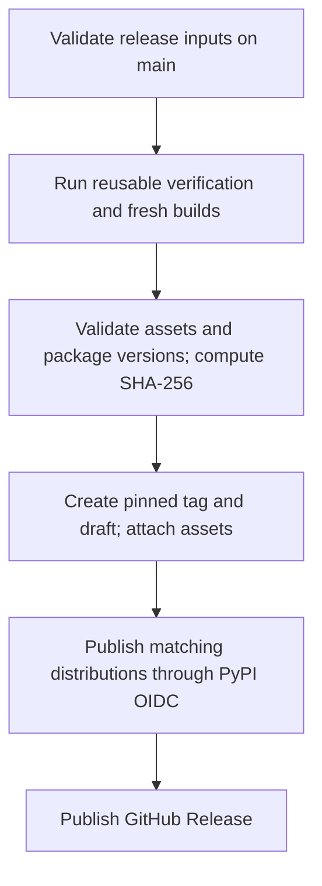

# Publishing YLSpec

Publishing is an explicit maintainer action. Ordinary pushes run verification
and create workflow artifacts, not GitHub Releases or PyPI uploads.

## Release inputs

| File | Responsibility |
|---|---|
| `release/release.json` | Authoritative version, title, notes path, prerelease flag |
| `release/notes/vVERSION.md` | Detailed English release notes |
| `release/assets.json` | Required native targets, wheel families, asset names |

CMake, Python package metadata, release scripts, and the Git tag derive their
version from `release.json`. Update that source once and include its notes in the
same commit. Do not commit compiled outputs into `release/`.

## One-time PyPI Trusted Publisher setup

No PyPI API token needs to be placed in GitHub Secrets.

1. Sign in to [PyPI](https://pypi.org/) and enable account two-factor
   authentication if required.
2. Open [account Publishing](https://pypi.org/manage/account/publishing/) and add
   a **pending GitHub publisher** for a new project.
3. Enter exactly these values:

| PyPI field | Value |
|---|---|
| PyPI project name | `ylspec` |
| Owner | `YoungLionOrganization` |
| Repository name | `YLSpec` |
| Workflow name | `publish.yml` |
| Environment name | `pypi` |

4. In the GitHub repository, open **Settings → Environments** and confirm `pypi`
   exists (create it if setting up a fresh clone of the workflow).
   If the repository plan supports environment protection, restrict publishing
   to `main` and the maintainers permitted to release. The original repository
   has its `pypi` environment configured with a `main` branch deployment policy.
5. Keep the publisher configuration matched to the workflow file and environment.

A pending publisher does not reserve a package name. The first successful upload
creates the project, provided the name remains available. Existing projects use
their project-level **Publishing** settings instead. Repository privacy does
not make PyPI distributions private: uploading publishes the source distribution
and wheels publicly. Keep public-release readiness in mind when dispatching.

See [PyPI's first-project instructions](https://docs.pypi.org/trusted-publishers/creating-a-project-through-oidc/)
and [OIDC publishing documentation](https://docs.pypi.org/trusted-publishers/using-a-publisher/).

## Dispatching a release

Open **Actions → Publish release → Run workflow** and select `main`.
The workflow pins the dispatch commit via `github.sha`. Moving `main` afterward
does not change the code being released.

Only the publishing job receives `id-token: write`; only release-management jobs
receive `contents: write`. External actions are pinned to recorded immutable
commits in `.github/action-pins.json`.

## Assets and provenance

The release contains five native `.tar.gz` packages, seven platform wheel
families, one source distribution, `SHA256SUMS`, and `build-manifest.json`.
The manifest records the source commit, release version, and artifact hashes.
The checksum file also covers the build manifest. Native archives contain both
static and shared installations, each with notices and CMake exports.

The pipeline verifies completeness before creating a draft. It does not take
an unrelated branch's "latest successful build" and attach it to a new tag.
The PyPA publishing action generates supported PyPI attestations.

## Failure and retry behavior

- Verification or missing assets: stop before release creation.
- Existing tag at another commit: fail without moving it.
- Existing asset with different bytes: fail without replacing it.
- PyPI/OIDC failure: retain the GitHub draft for inspection; fix the publisher
  configuration and rerun failed jobs to reuse the same staged artifacts.
- Existing PyPI filename: compare the published SHA-256 before skipping it.
  Different bytes require a new version.
- GitHub finalization failure after PyPI success: rerun failed finalization;
  publishing cannot be rolled back atomically across the two services.

Rerun failed jobs in the same workflow run where possible. A fresh run rebuilds
artifacts, and different binary bytes will correctly prevent replacement of an
existing release asset. PyPI does not allow reusing deleted filenames.

After the first public PyPI publication, add PyPI version and distribution badges
using the real project URL and verify them. Keep experimental status visible.
