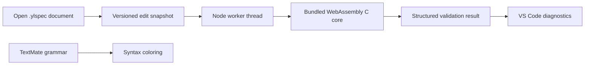

# Visual Studio Code integration

The [extension README](../editors/vscode/README.md) describes installation,
settings, commands, and expected editor behavior. Version 0.1.2 is packaged as
`ylspec-0.1.2.vsix`; the binary is a required release output. Its extension ID is
`ylvsmp.ylspec`.

## Architecture

The engine uses the same internal typed-value adapter as the browser package.
The worker reads only its bundled engine assets. Document parsing performs no
file includes, environment substitution, project execution, or network requests.
The extension host remains available while the worker parses. Stale results are
discarded when the document version changes or the document closes.

## Compatibility

| Surface | Support |
|---|---|
| Desktop VS Code | 1.95+ with a Node-enabled extension host |
| Remote SSH / containers / Codespaces | Runs in the workspace extension host |
| Virtual or untrusted workspace | Supported; validation does not execute workspace code |
| Browser-only vscode.dev | Active engine execution is outside the initial target |
| Standalone `.ylspec` text | Highlighting, diagnostics, completion, hover, snippets, optional formatting |
| Binary frames and future host formats | Use the library APIs; binary editing is outside editor scope |

Custom profiles remain readable. The generic `core.data` profile is validated;
an unknown profile raises a warning. The editor does not import arbitrary
validators from a workspace. Unsupported required features are errors.

## Formatting contract

The formatter serializes values through C. It does not preserve comments,
whitespace, key layout, or original literal spelling. Consequently,
`ylspec.format.enabled` defaults to false. A user must opt into that documented
behavior. Resource limits also apply to formatting. Invalid documents and stale
requests do not produce replacement edits.

## Build and verification

All repository verification runs on GitHub Actions. The `languages.yml` workflow:

1. Downloads the WebAssembly artifact from the same workflow run.
2. Runs `scripts/prepare_editor.py` to copy the shared engine and all legal notices.
3. Renders the repository-owned SVG icon into the Marketplace-required PNG.
4. Tests table-context scoping, UTF-8-to-UTF-16 diagnostic positions, and real
   TextMate/Oniguruma tokenization.
5. Launches a real VS Code Extension Host under Xvfb and exercises validation,
   unsupported profiles, completions, and formatting.
6. Packages a universal VSIX with `vsce` and uploads `editor-package`.

The release assembly requires the VSIX and includes its SHA-256 in the build
manifest and checksum file. See [registry publishing](registries.md) for a
separate Marketplace upload of those verified bytes.

The Marketplace publisher is `ylvsmp` and its active GitHub Trusted Publishing
policy authorizes `YoungLionOrganization/YLSpec` and `publish-vscode.yml`.
The workflow validates the embedded `ylvsmp.ylspec` identity, requests an OIDC
token only in the upload job, and invokes VSCE with `--oidc`. It does not use a
stored PAT. The earlier manual 0.1.1 VSIX had a different publisher identity;
see [migration notes](../release/notes/v0.1.2.md) before switching installations.

Copyright 2026 Cavanşir Qurbanzadə. SPDX-License-Identifier: Apache-2.0.
